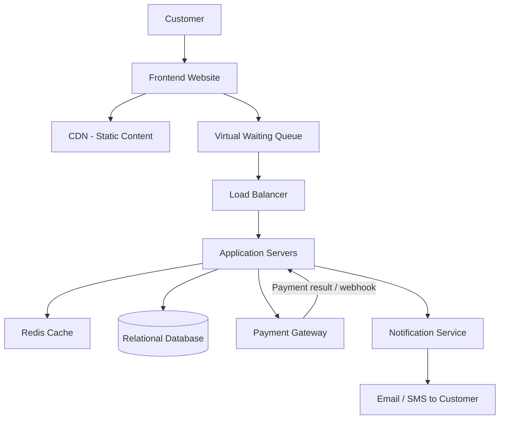

# TicketHub – Event Ticketing System Design

## 1. Requirements

### Functional Requirements
- Users can register and log in.
- Users can browse events.
- Users can view available seats.
- Users can select and hold seats.
- Users can pay for tickets and receive confirmation.

### Non-Functional Requirements
- Performance
- Scalability
- Reliability
- Security
- Data consistency


## 2. Traffic and Capacity Estimates

### Normal Daily Traffic

The system receives 50,000 visitors per day. Each visitor views approximately 10 pages.

- Daily page views = 50,000 × 10 = 500,000 page views.
- Average page views per second = 500,000 ÷ 86,400 ≈ 5.8 page views per second.
- Daily ticket sales = 5,000 tickets.
- Average ticket sales per minute = 5,000 ÷ 1,440 ≈ 3.5 tickets per minute.

These figures represent average daily traffic. Actual traffic may be higher during busy periods.

### Peak Traffic During a Popular Concert Sale

For a popular concert, 200,000 people attempt to purchase 20,000 available seats within 10 minutes.

- Total purchase attempts = 200,000.
- Available seats = 20,000.
- Average purchase attempts per second = 200,000 ÷ 600 ≈ 333 attempts per second.
- Demand-to-supply ratio = 200,000 ÷ 20,000 = 10:1.
- Approximately 10% of attempts can succeed if each attempt is for one seat.

### Capacity Considerations

The system must be designed to handle sudden increases in traffic during popular ticket sales. It should use a virtual waiting queue to manage incoming users, prevent the servers from becoming overloaded, and ensure that available seats are not sold more than once.


## 3. API Design

The TicketHub system uses REST API endpoints to allow the frontend to communicate with the backend. The endpoints support event browsing, seat selection, ticket purchasing, payments and ticket management.

| HTTP Method | Endpoint | Purpose |
|---|---|---|
| GET | /api/events | Retrieves a list of available events. |
| GET | /api/events/{eventId} | Retrieves details about a specific event. |
| GET | /api/events/{eventId}/seats | Retrieves the seats for an event and their availability status. |
| POST | /api/events/{eventId}/seat-holds | Temporarily reserves selected seats for a user while they complete payment. |
| POST | /api/orders | Creates a pending order using a valid seat hold. |
| POST | /api/payments | Initiates payment for an order. |
| GET | /api/orders/{orderId} | Retrieves the status and details of an order. |
| GET | /api/users/me/tickets | Retrieves the tickets belonging to the logged-in user. |

### How the API works

1. A user requests the available events using GET /api/events.
2. The user selects an event and views available seats using GET /api/events/{eventId}/seats.
3. The user selects seats and sends a POST request to /api/events/{eventId}/seat-holds. The backend temporarily holds the seats for a limited period, such as five minutes.
4. The user proceeds to checkout, and the backend creates a pending order using POST /api/orders.
5. The user initiates payment through POST /api/payments.
6. Once payment is successfully verified, the backend confirms the booking and makes the tickets available through the user's account.
7. The user retrieves their purchased tickets using GET /api/users/me/tickets.

### API Error Handling

The API should return appropriate HTTP status codes to communicate the outcome of requests.

- 200 OK: The request was successful.
- 201 Created: A new resource, such as an order, was created.
- 400 Bad Request: The request contains invalid information.
- 401 Unauthorized: The user is not authenticated.
- 404 Not Found: The requested event, seat or order does not exist.
- 409 Conflict: A seat is no longer available or cannot be held because another user has already reserved it.


## 4. Database Design

TicketHub uses a relational database to store and manage users, events, seats, orders, payments and tickets.

The database contains the following six tables.

### Table 1: Users

Stores information about registered customers.

| Field | Description | Constraint |
|---|---|---|
| user_id | Unique customer identifier | Primary Key |
| full_name | Customer's full name | NOT NULL |
| email | Customer's email address | UNIQUE, NOT NULL |
| password_hash | Securely hashed password | NOT NULL |
| created_at | Account creation date | NOT NULL |

### Table 2: Events

Stores information about concerts and other events.

| Field | Description | Constraint |
|---|---|---|
| event_id | Unique event identifier | Primary Key |
| title | Event name | NOT NULL |
| venue | Event location | NOT NULL |
| event_date_time | Date and time of event | NOT NULL |
| status | Event status, such as scheduled or cancelled | NOT NULL |

### Table 3: Seats

Stores the seats available for each event.

| Field | Description | Constraint |
|---|---|---|
| seat_id | Unique seat identifier | Primary Key |
| event_id | Identifies the event | Foreign Key referencing events |
| seat_number | Seat identification, such as A15 | NOT NULL |
| section | Seating area | NOT NULL |
| price | Ticket price | NOT NULL |
| status | Available, held or booked | NOT NULL |
| held_by_user_id | User currently holding the seat | Foreign Key referencing users; nullable |
| hold_expires_at | Time when a temporary hold expires | Nullable |

A UNIQUE constraint on (event_id, seat_number) ensures that the same seat number cannot be created twice for one event.

### Table 4: Orders

Stores purchase orders made by customers.

| Field | Description | Constraint |
|---|---|---|
| order_id | Unique order identifier | Primary Key |
| user_id | Customer who placed the order | Foreign Key referencing users |
| event_id | Event being purchased | Foreign Key referencing events |
| total_amount | Total purchase amount | NOT NULL |
| status | Pending, paid, failed, cancelled or expired | NOT NULL |
| created_at | Date and time the order was created | NOT NULL |

### Table 5: Payments

Stores payment transaction information.

| Field | Description | Constraint |
|---|---|---|
| payment_id | Unique payment identifier | Primary Key |
| order_id | Order associated with the payment | Foreign Key referencing orders |
| provider_reference | Payment provider's transaction reference | UNIQUE |
| amount | Amount paid | NOT NULL |
| status | Pending, successful or failed | NOT NULL |
| paid_at | Time payment was confirmed | Nullable |

An order can have multiple payment attempts, but each payment record belongs to one order.

### Table 6: Tickets

Stores tickets issued after successful payment.

| Field | Description | Constraint |
|---|---|---|
| ticket_id | Unique ticket identifier | Primary Key |
| order_id | Order associated with the ticket | Foreign Key referencing orders |
| seat_id | Seat assigned to the ticket | Foreign Key referencing seats; UNIQUE |
| ticket_code | Unique ticket verification code | UNIQUE |
| issued_at | Date and time the ticket was issued | NOT NULL |

The UNIQUE constraint on seat_id ensures that the same seat cannot appear in multiple issued tickets.

### Relationships Between Tables

The database has the following relationships:

1. One user can place many orders. Each order belongs to one user.
2. One event can have many seats. Each seat belongs to one event.
3. One event can have many orders. Each order relates to one event.
4. One order can have multiple payment attempts. Each payment belongs to one order.
5. One order can contain multiple tickets. Each ticket belongs to one order.
6. One seat can appear in at most one issued ticket.

### Database Integrity and Consistency

The database uses primary keys, foreign keys and unique constraints to maintain accurate information.

- Every customer must have a unique email address.
- Every seat must belong to an existing event.
- A seat number must be unique within its event.
- Every order must belong to an existing user and event.
- Every ticket must reference an existing order and seat.
- A seat can only be assigned to one issued ticket.

The system also updates seat availability within database transactions. This helps prevent two customers from successfully booking the same seat.


UPDATE seats
SET status = 'held',
    held_by_user_id = ?,
    hold_expires_at = ?
WHERE seat_id = ?
AND status = 'available';

The backend checks how many rows were updated. If one row was updated, the seat was successfully held. If zero rows were updated, the seat was no longer available. This conditional update prevents two customers from successfully holding the same available seat at the same time.

## 5. System Architecture

TicketHub uses a client-server architecture with multiple application servers, a relational database, caching and a virtual waiting queue. This design supports normal daily traffic and helps manage sudden increases in demand during popular ticket sales.

### Architecture Diagram



### Explanation of Components

1. **Frontend Website:** This is the interface customers use to register, browse events, select seats, make payments and access their tickets.

2. **Content Delivery Network (CDN):** Delivers static files such as images, stylesheets and JavaScript files. This reduces the work required from the main application servers and improves page-loading performance.

3. **Virtual Waiting Queue:** Controls the number of customers allowed to proceed to the purchasing process during high-demand sales. Customers who cannot proceed immediately wait in a queue. This helps prevent the backend from being overwhelmed.

4. **Load Balancer:** Distributes incoming requests across multiple application servers instead of sending all requests to one server.

5. **Application Servers:** Process customer requests, enforce business rules, manage seat reservations, create orders and coordinate payments. They are stateless, meaning that customer session information is not stored only on one server. This allows requests to be handled by different servers.

6. **Redis Cache:** Stores frequently requested information, such as event details, to reduce repeated database queries. The database remains the authoritative source for seat availability and booking status.

7. **Relational Database:** Stores permanent records, including users, events, seats, orders, payments and tickets. Database transactions and constraints protect the integrity of booking information.

8. **Payment Gateway:** Processes payments securely. After payment, it sends the result to the application backend. The backend verifies the payment before confirming the order and issuing tickets.

9. **Notification Service:** Sends booking confirmations and ticket details to customers through email or SMS after successful payment and booking confirmation.

### How the Architecture Works

1. A customer visits TicketHub and accesses the website.
2. The CDN delivers static content, while the frontend communicates with the backend for dynamic information.
3. During a popular ticket sale, customers pass through the virtual waiting queue before reaching the purchasing system.
4. The load balancer distributes requests across available application servers.
5. Application servers retrieve frequently requested event information from Redis or the database.
6. When a customer selects a seat, the application server requests a temporary reservation in the relational database.
7. The customer proceeds to payment through the payment gateway.
8. The backend verifies the payment result and confirms the booking in the database.
9. The notification service sends the customer a booking confirmation and ticket information.

### Preventing Double Booking

The relational database is the authoritative source for seat availability. When a customer requests a seat, the backend uses a database transaction and an atomic update to ensure that the seat can only be held by one customer at a time.

If another customer attempts to reserve the same seat, the database rejects the conflicting request. After successful payment, the booking is confirmed and a ticket is issued. Temporary holds that expire without successful payment are released so that other customers can purchase those seats.
```

### 3. Understand three important architecture decisions

**A. Why use a virtual waiting queue?**

During the concert sale, approximately 333 purchase attempts occur per second on average. A queue regulates how many customers enter the purchasing process at once. This reduces the risk of overwhelming the application servers.

**B. Why use multiple application servers?**

Suppose one application server receives more requests than it can handle. A load balancer can distribute requests across several servers. If one server fails, the remaining servers can continue handling requests.

**C. Why use both Redis and a relational database?**

Redis makes frequently accessed information faster to retrieve. The relational database stores permanent records and protects booking consistency. We must not rely on cached seat availability to confirm a purchase.

### Check your understanding

{@body const [answer,setAnswer] = DIL.useState("b")}
{@body const [submitted,setSubmitted] = DIL.useState(false)}
<box border radius="lg" padding={3} gap={3}>
  **What is the main responsibility of a load balancer in TicketHub?**
  <radio-group direction="col" value={answer} onChange={v=>{setAnswer(v);setSubmitted(false);}}>
    <radio value="a">To permanently store customer orders.</radio>
    <radio value="b">To distribute incoming requests across multiple application servers.</radio>
    <radio value="c">To process customer payments.</radio>
    <radio value="d">To generate event posters.</radio>
  </radio-group>
  <button block onClick={()=>setSubmitted(true)}>Check answer</button>
  {#if submitted}
    <box background="surface-secondary" radius="md" padding={2}>
      {#if answer==="b"}
        <text color="success" weight="semibold">Correct.</text>
        A load balancer distributes incoming traffic across multiple servers, helping the system handle more requests.
      {:else}
        <text color="danger" weight="semibold">Incorrect.</text>
        The correct answer is B. A load balancer distributes incoming requests across application servers.
      {/if}
    </box>
  {/if}
</box>


## 6. Design Trade-offs

System design involves making decisions that balance performance, reliability, complexity and consistency. TicketHub uses the following design choices.

### Trade-off 1: Virtual Waiting Queue vs Direct Access

TicketHub uses a virtual waiting queue during high-demand ticket sales instead of allowing all customers to access the purchasing process simultaneously.

Advantages:
- Controls the number of users entering the purchasing process.
- Reduces the risk of overwhelming application servers.
- Helps regulate traffic during popular ticket sales.

Disadvantages:
- Customers may have to wait before purchasing.
- Requires additional infrastructure and management.
- Introduces another component that could fail.

Reason for the decision: During a popular concert sale, 200,000 people may attempt to purchase only 20,000 seats. A virtual waiting queue helps regulate traffic and protects the purchasing system from sudden overload.

### Trade-off 2: Redis Caching vs Direct Database Access

TicketHub uses Redis to cache frequently accessed information instead of retrieving all information directly from the database.

Advantages:
- Improves response times for frequently requested information.
- Reduces repeated database queries.
- Reduces pressure on the relational database.

Disadvantages:
- Cached information may become outdated.
- Requires cache invalidation or updating.
- Adds another component to maintain.

Reason for the decision: Event information is frequently accessed by customers. Caching this information improves performance. However, the relational database remains the authoritative source for seat availability and booking confirmation.

### Trade-off 3: Relational Database vs NoSQL Database

TicketHub uses a relational database to manage its structured information and transactions.

Advantages:
- Supports relationships between users, events, seats, orders and tickets.
- Supports transactions and data consistency.
- Supports constraints that help prevent duplicate bookings.

Disadvantages:
- Transaction processing can introduce overhead during high traffic.
- Requires careful database design.
- Scaling database writes may require additional infrastructure.

Reason for the decision: TicketHub handles payments and seat reservations. It needs reliable transactions and consistent records to prevent customers from purchasing the same seat. A relational database is therefore a suitable choice.

